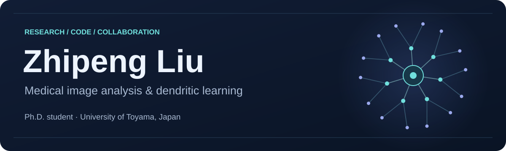
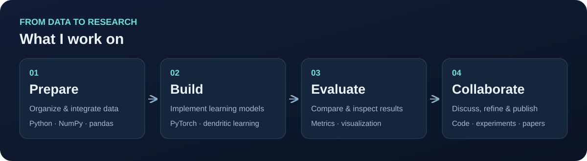

**Zhipeng Liu · 劉 志鵬**

[Google Scholar](https://scholar.google.com/citations?hl=zh-CN&user=2r4K18sAAAAJ) &nbsp; · &nbsp; [Research Lab](https://toyamaailab.github.io/) &nbsp; · &nbsp; [Featured Work](#selected-research)

## About

I am a doctoral student in the Graduate School of Science and Engineering at the **University of Toyama, Japan**. My research focuses on **medical image analysis** and **dendritic learning**: bringing biologically inspired neuron models into deep learning for segmentation and classification.

My work spans model implementation, data preparation, comparative experiments and visualization. I develop in Python and PyTorch and collaborate with fellow researchers on code, experiment design and publications.

## Selected Research

### 01 · 3DL-Net
**Global context and local detail for medical image segmentation**

Multi-scale dilated convolutions meet dendritic feature learning. Explore the model implementation, four-fold training workflow and prediction utilities.

*Expert Systems with Applications · 2025 · First author*

**[Paper ↗](https://doi.org/10.1016/j.eswa.2024.125874)** &nbsp; · &nbsp; **[Code & method guide →](https://github.com/lzp990616/3DL-Net)**

### 02 · DDNet
**Dendritic deep learning for medical segmentation**

Research on dendritic learning for medical image segmentation, with the accompanying model code.

*IEEE/CAA Journal of Automatica Sinica · 2024 · First author*

**[Paper ↗](https://ieeexplore.ieee.org/abstract/document/10433406)** &nbsp; · &nbsp; **[Code →](https://github.com/lzp990616/DDNet)**

### 03 · Dendritic Kernel CNN
**Learning to segment breast ultrasound images**

Collaborative research on dendritic kernel convolutional neural networks for breast ultrasound image segmentation.

*IEEE Transactions on Systems, Man, and Cybernetics: Systems · 2025 · Co-author*

**[Paper ↗](https://ieeexplore.ieee.org/document/11203775)** &nbsp; · &nbsp; **[Code →](https://github.com/lzp990616/Segment_dnm)**

## Tools I Use

**Models** &nbsp; Python · PyTorch  
**Data & evaluation** &nbsp; NumPy · pandas · Matplotlib  
**Development** &nbsp; Linux · Git

For more publications, visit my [Google Scholar profile](https://scholar.google.com/citations?hl=zh-CN&user=2r4K18sAAAAJ).
